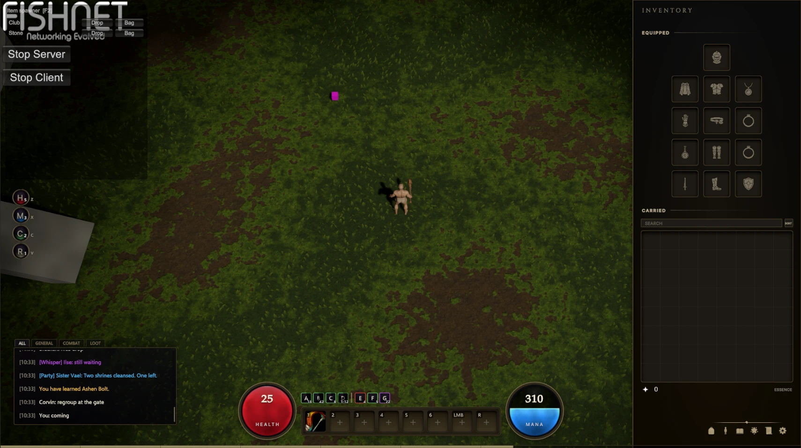

# Rebirth

A multiplayer action RPG in Unity, built solo. In development.

## Stack

- Unity 6 (6000.3), C#, URP
- FishNet for networking
- UI Toolkit for the HUD and inventory
- SQLite for accounts and characters

## What's in it

- **Combat.** Melee swings use hitboxes that sweep the whole span of the swing,
  so a fast attack can't skip past a target between ticks. Bodies have
  hurtboxes, and each attack sets its own knockback. Blocking and dashing are
  checked on the server.
- **Projectiles.** A shot is a curve the game can query at any time, with one
  clock for the draw and one for the flight. The client shows the shot at once;
  the server decides whether it hit.
- **Movement.** Client-side prediction with server reconciliation, through
  FishNet's replicate/reconcile.
- **Abilities.** Defined as data assets, learned per character, paid for with
  mana the server owns, and bound to an action bar.
- **Items.** A grid inventory, equipment slots, items dropped as networked
  objects, and loot tables.
- **Accounts and saves.** Login ties a character to an account. The server
  loads and saves characters to SQLite.
- **Enemies.** AI that picks targets from a threat table.
- **Vision.** Fog of war worked out on the server, so hidden players are never
  sent to a client.

## Layout

| Folder | Runs on |
| --- | --- |
| `Assets/Scripts/Client` | The player's machine only: UI, effects, camera, aiming |
| `Assets/Scripts/Shared` | Both ends: networked components, item data, combat |
| `Assets/Scripts/Server` | The server only: login, saves, loot |

## Running it

Open `Assets/Scenes/Scene_1.unity` and press Play. The editor starts as host.
For a second player, use Multiplayer Play Mode to add a virtual player.

## Next

- A dedicated server build that leaves client code out
- Rewinding positions to compensate for lag when checking hits
